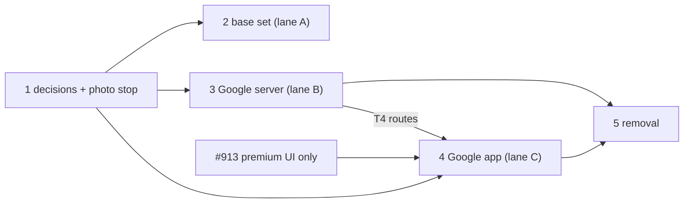

# Destinations base set and Google Places

| Field | Value |
|---|---|
| Goal | Any town a crew might pitch is in the vote with a real photo, a facts-only line and a critter guide; every place on Earth can be searched, opened, photographed and saved through Google; our own layer (profiles, briefs, notes, stops) keeps working keyed by Google `place_id`; the 9.2 GB open-data index, its jobs and the map packs are gone |
| Founder decisions | 14 Oct 2026, binding: (1) base set of ~5,000 (Wikidata with a Wikivoyage article and ≥ 10 sitelinks, GeoNames `cities15000` gap fill, per-country cap, Vietnam top-up with a one-time LLM pass), Commons photos with licence rows, facts-only LLM text; (2) each destination gets one of the 151 critters, neighbours share; (3) Google Places API (New) + Google Maps in the app, Map ID styling (carried out with JSON styles instead: decision 9 below); (4) no in-app offline map; (5) our layer keyed by `place_id`; (6) delete the open-data index, ingest, scraped photos (first), map packs, Mapbox geocoding, search indexes, `places.pick`, last, after staging ran the new path |
| Read at | `origin/main` 3d8ff4078 (13 Oct), worktree `/Volumes/CPLanes/critterpass-worktrees/places-google-plan`. Implementers branch from `origin/main` |
| Inputs | `plans/reports/brainstorm-261014-1153-destinations-and-places-on-demand-report.md` (option A), `researcher-261014-1146-{destination-base-set,on-demand-place-providers,agentic-place-data-approaches}-report.md`, `data-sources-audit-261014-0123-…-report.md` (primary checkout, untracked) |
| Rules | `CLAUDE.md` (worktree copy): owns lists, one commit per task, test ladder (database files via `pnpm test:remote`), device runs on GitHub Actions (Android default; iOS for the Google map itself), native builds only through `native-build.yml` (`eas build --local`), `ui-reviewed` gate, no plan/phase/task ids in code, hand-written migrations with forced RLS + grants + privacy class + permission test, mobile schema regen after synced-table changes, undesigned states logged |
| Production | No production users: `release.yml` "has never been run" and only a `staging` GitHub environment exists (`docs/runbooks/release.md:6,13`). Staging trips are **migrated, not reset** (the founder's Đà Lạt test trip is 22–25 Oct) |

## What is true today (3d8ff4078)

- **Destinations:** ~152 rows: 7 seeded, one per critter city from `app.sync_place_destinations()` (`20261004134500_city_critter_guides.sql:76-109`), AI `area` rows (`brief-links-store.ts:196`). No centre point; `country` holds the set's name (`seed/destinations.ts:12`). All non-area rows sync to every phone (`infra/powersync/streams/core.yaml:167`). Vote search: `GET /v1/places?q` (`services/api/src/routes/places-search.ts:74-148`).
- **Places:** `pois` ≈ 10 M rows (Overture + FSQ OS + OSM), not in the PowerSync publication (`packages/db/src/publication.ts:91-94,185`). 26 FK columns and 17 commands carry a `poi_id`; phones get places as `trip_places`/`place_cards` sent `AS pois` (`infra/powersync/streams/places.yaml:28-77`).
- **Details:** Foursquare live (D24/D25), Mapbox address geocoding (D27), AI profiles and briefs keyed by `poi_id`; briefs match names to open-data rows (`brief-match.ts:106`, `brief-run.ts:141,161`).
- **Maps:** `@maplibre/maplibre-react-native` 11.4.0 (`apps/mobile/package.json:35`, plugin `app.config.ts:301`) in 45 files behind `CpMap`, `PlanningMapCanvas`, `PremiumMapCanvas` + 3 direct screens; PMTiles packs from `map-regions.yml`. No Google Maps key anywhere.
- **Scraped photos:** `services/worker/src/places/profile/run.ts:135,220-221` → `photos.ts:28` re-hosts web image-search hits; read at `services/api/src/places/profile.ts:134`, `place-photo.ts:18-23`.

## Target shape

| Concern | After this plan |
|---|---|
| Destination list | `destinations` holds ~5,000 rows; base rows (`origin = 'base'`) are searched through the api and synced only when a crew's trip, poll or pitch names them |
| Place identity | `pois` stays as **our place registry** (name kept: renaming touches ~480 files for no behaviour). New `google_place_id text UNIQUE`; every existing `poi_id` keeps its value, so no FK, command, stream or phone row changes |
| What we store per place | `google_place_id` (indefinitely); our label (`name`: crew-confirmed, AI-proposed, or the migrated open-data name), our category, our hours facts, editorial notes; Google coordinates at most 30 days (`location_source = 'google'`, refreshed while needed, else nulled); never Google names, addresses, hours, ratings, prices or photos |
| Google content | Live through `services/api` only, per-screen field masks, `no-store`, never persisted on phones, never in model context (the D24 rule, applied to Google) |
| Maps | `react-native-maps` with `PROVIDER_GOOGLE` on iOS and Android, light and dark looks as bundled `customMapStyle` JSON |
| Offline trip day | The trip stream as today (stops, labels, times, notes, our own addresses, legs) + "Open in Google Maps" (`query_place_id`); no in-app offline map |
| Reasoning | Fit, plan check, draft, legs and the guide read our layer and our stored points only |

## Phases

| # | Phase | Lane | Depends on | Done when | Rollback | Status |
|---|---|---|---|---|---|---|
| 1 | [Decisions, contracts and the photo stop](./phase-01-decisions-contracts-photo-stop.md) | B | – | No web image is fetched or served; R2 `c/place-profiles/` empty; D38, D39, the ADR and contract deltas merged | Revert the docs; the photo stop is not undone | pending |
| 2 | [Destination base set and critter match](./phase-02-destination-base-set.md) | A | 1 T2 (docs only; T1–T6 start at once) | 4,500–5,500 rows on staging; ≥ 85 % with a licensed photo; 100 % with a critter and method; vote search finds "Quy Nhơn"; synced destination rows per phone unchanged ± trips | Switch `destinations.base_search` off; base rows are additive and deletable | pending |
| 3 | [Google Places on the server and the place registry](./phase-03-google-places-server.md) | B | 1 | Google routes live on staging; every kept place has a registry row and ≥ 90 % a `place_id`; briefs resolve through Google; caps enforced; no Google field written (tests) | Switch `places.google` off: routes answer "unavailable", the app shows our layer; columns additive | pending |
| 4 | [The app on Google Maps and Google places](./phase-04-app-google-maps-places.md) | C | 1; #913 merged; 3 T4 for T5–T8 | Every map screen draws the Google map in light and dark on both platforms; search, place page and photos on Google; airplane-mode trip day passes; sheets reviewed | Reinstall the previous native build (old routes live until phase 5); JS fixes by update to the new runtime | pending |
| 5 | [Remove the old place and map path](./phase-05-remove-old-place-and-map-path.md) | B | 3 and 4 on staging ≥ 7 days incl. a green Android happy gate and the founder's live use; testers on the new build | Delete list gone; `pois` ≤ 50 k rows; database ≥ 8 GB smaller; docs match the code | Code: revert. Data: restore `pois` from the pre-drop dump on R2 | pending |

Lanes: **A** (destinations, server + data) starts now and ships its own PR. **B** (P1, then P3, then P5) and **C** (P4) share the integration branch `feat/google-places`: milestone 1 = P3 + P4 (one CI run, one Android sweep, one iOS map sheet, one PR); milestone 2 = P5. P1 merges on its own at once (legal exposure).

## Decisions taken here (reversible; reasoning in phase files)

| # | Call | Why |
|---|---|---|
| 1 | Keep `pois` as the registry and add `google_place_id`, not a new table or text keys everywhere | Ids stay, so 26 FK columns, 17 command contracts, both streams and every phone row are untouched; a moved Google id is a one-row update |
| 2 | Migrate staging, don't reset | Ids unchanged; resolving kept rows is Text Search IDs-only (free); the founder's test trip keeps its data |
| 3 | The app never calls Places directly; `services/api` proxies with session tokens, field masks, caps and a kill switch | One restricted server key, budgets enforced in one place, no Google content in app caches |
| 4 | Lists show our label + Essentials fields; `displayName` (Pro) and hours/rating/price (Enterprise) only on the place page | Matches decision 3's cost rule; Place Details Essentials (IDs Only) gives photo names free |
| 5 | Google coordinates kept ≤ 30 days: refreshed daily for places of trips not ended (+ 14 days) and of destinations with activity in 30 days; nulled otherwise | The storage rule as researched; migrated open-data points are ours and never expire |
| 6 | Plain-words search uses Google Text Search Pro with request filters (`openNow`, `priceLevels`); gap ideas use Nearby Search Pro; both display-only until saved | Keeps 7d-2 and 7h-2 useful once the open-data rows are gone, without Enterprise fields |
| 7 | Address search moves to Google Autocomplete (address predictions); `GET /v1/geocode` forward and D27 retire; reverse geocode keeps `cities` only | One search box; Mapbox stays for Directions/Matrix |
| 8 | Map SDK: `react-native-maps` + `PROVIDER_GOOGLE`. `expo-maps` is out (Apple Maps on iOS); one native build replaces MapLibre outright, no dual SDK | Google's map rule on both platforms; old builds keep working against old routes until phase 5 |
| 9 | Light and dark styles are `customMapStyle` JSON in the bundle, not cloud Map IDs (founder decision 3 named a Map ID) | Same colours and feature visibility; no console-only step; switches with the theme at runtime; restyle by JS update; no Dynamic Maps billing per load (a Map ID bills after 10 k loads a month). A Map ID becomes a small browser step only if a style needs cloud-only features |
| 9a | The two mobile key values are left out of the native fingerprint | Keys live in EAS env and GitHub secrets; a machine without them must not compute a different runtime version (the Firebase-file pattern) |
| 10 | `place_cards` streams stay (our own rows: curated + brief places) | No Explore re-architecture now; D31's "trip's own places" is honoured by `trip_places` |
| 11 | Base set built in the worker (monthly job), not GitHub Actions | It needs the database, DeepSeek and Jev; inputs are ~10 MB |
| 12 | Base rows get `critter_key` but no `critter_set_id` | Guides follow the critter (D29 as amended); the public locals page joins on the set (`20261007100000_locals_place_public_view.sql:62`) and stays limited to the 61 places |
| 13 | Routing unchanged: Valhalla legs from registry points, Mapbox live ETAs. Base rows get a default `place_bounds` box so routing boxes and autocomplete bias work | `routes/routing-boxes.ts:46-65` reads `place_bounds`, then geofence, then the `pois` extent |

## Google setup (done 14 Oct 12:30) and what is left

Done by the founder: project `critterpass-e3c73` (shared with Firebase), billing linked, a 5,000,000 VND/month budget alert, Places API (New) + Maps SDK for iOS + Maps SDK for Android enabled. Keys: `GOOGLE_PLACES_API_KEY` (server, Places API (New) only; root `.env`, Railway staging api + worker), `GOOGLE_MAPS_IOS_API_KEY` (Maps SDK for iOS; bundle ids `app.critterpass`, `.staging`, `.dev`; root `.env`), `GOOGLE_MAPS_ANDROID_API_KEY` (Maps SDK for Android, API-restricted only; root `.env`).

Left, planned as tasks: mobile keys into EAS env and GitHub secrets + `.env.example` names (4 T1); the Android package + SHA-1 restriction through `gcloud` (4 T1); per-method daily quotas and an optional server-key IP restriction (3 T3); production server key and caps before launch (3 T3).

## Founder gates

| Gate | What | Blocks |
|---|---|---|
| G4 | Counsel read (does not block staging): crew label prefilled from Google's name, category derived from Google `types`, the 30-day coordinate rule, attribution layout | Launch |
| (only if needed) | A cloud Map ID created in the console, if 4 T1 finds a style that JSON cannot express | 4 T2 |

Controller (on the founder's behalf, 4 Oct autonomy): the one-time spot check of the Vietnam top-up list (2 T5).

## Shared files and integration points

| File | Rule |
|---|---|
| `infra/powersync/sync-streams.yaml`, `apps/mobile/src/data/powersync/synced-tables.generated.ts` | Generated. Lane A (destinations) and lane B (`pois`, `trip_places`, `place_cards` columns) both change inputs: whichever merges second rebases and re-runs `pnpm tsx infra/powersync/build-config.ts` and `pnpm --filter @cp/mobile exec tsx src/data/powersync/test-support/synced-schema-source.ts --write`, never hand-merges |
| `services/worker/src/job-registry.ts`, `packages/domain/src/jobs/feature-queues.ts`, `services/{api,worker}/src/env.ts`, `.env.example` files | Append-only lines per lane |
| `packages/ai/src/routing.ts`, `packages/domain/src/ai/routes.ts`, `decision-thresholds.ts` | Lane A adds three routes (P2); lane B removes `places.pick` only in P5, after lane A merged |
| `packages/domain/src/admin/service-keys.ts` | Append-only: `destinations.base_search.enabled` (A), `places.google.enabled` (B) |
| `docs/runbooks/google-maps-setup.md` | Created by 4 T1 (keys, restrictions, styles); 3 T3 appends quotas and the server key section |
| `docs/**` | Phase 1 writes every delta up front; phase 5 T4 reconciles. Lanes only append to `docs/undesigned-states.md` (lane C) |

## Test matrix

| Level | What |
|---|---|
| Unit | Base-set join, dedupe, rank and cap; critter matcher (single-critter country, cross-border region, island, near tie); field mask → SKU table; autocomplete session lifecycle; coordinate expiry rule |
| Contract (recorded fixtures, network boundary) | Google Autocomplete, Details (each mask), Text Search IDs-only and Pro, Nearby, Photo media; Wikidata SPARQL; GeoNames; Commons metadata |
| Database (`test:remote`) | `app.reserve_google_places_call` concurrency and refusal; registry backfill keeps ids; pick writes only allowed columns; location refresh and nulling; base build never overwrites seed/critter rows; permission tests for new columns/tables |
| Evals | `destination.critter` (Jev) and `destination.describe` routes |
| Device (Actions) | Android: search → pick → add to plan; place page with photos; places map; trip map; airplane-mode trip day; vote search for a base town. iOS: Google map light/dark and sheets |
| Live | Fresh-user Android happy gate on staging with the Google path, then the founder's use before phase 5 |

## Top risks

| Risk | L×I | Mitigation |
|---|---|---|
| Google spend runs away | M×H | Per-SKU monthly caps in our usage table, per-user limits, Essentials masks on lists, photos lazy and one per card, `places.google` kill switch, the 5,000,000 VND budget alert, per-method daily quotas (3 T3) |
| Storing Google content by accident | M×H | Pick/resolve write only allowed columns (DB test); `no-store` responses; app query persistence excludes Google blocks (test); coordinate expiry job (DB test); G4 |
| `react-native-maps` on RN 0.88 New Arch misses styles, markers or padding | M×M | 4 T1 proves them on Android and iOS before any port |
| Map key values move the native fingerprint and strand installed builds | M×H | 4 T1 keeps them out of the hash (test) |
| Android key unrestricted until 4 T1 | M×M | Restrict before the first staging build is shared |
| Many markers slow on the Google provider | M×M | Bitmap markers, the existing JS clustering, visible-only rendering; `planning-map-perf.yaml` budget |
| Backfill matches a wrong Google place | M×M | Name + ±150 m `locationRestriction`; unresolved rows stay our own places and still work; per-destination report |
| Lane C waits on #913 | H×M | 4 T1 (native module, keys, proof scene) and T2 (styles) touch no screen and start at once |
| Installed builds strand after the native build (4 Oct incident) | M×H | Old routes stay until phase 5; switch the update loop to the new build the day it reaches TestFlight |

## Open follow-ups (not tasks)

- Google Routes API instead of Mapbox + Valhalla (cost and one vendor); revisit after launch numbers.
- Guide place search covers our layer only (curated, brief, saved); Grounding with Google Maps would add a second AI provider.
- Renaming `pois` to `places` once nothing else is moving.
