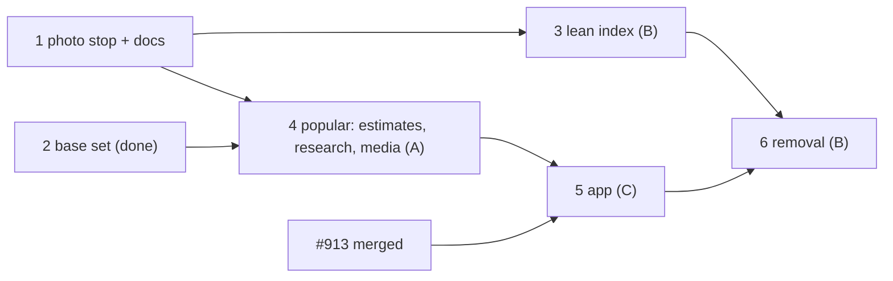

# Destinations base set and lean places

| Field | Value |
|---|---|
| Goal | Any town a crew might pitch is in the vote with a photo, a facts-only line and a critter guide. Places stay our own open data, small and travel-only. Popular places get AI estimates (busy times, visit length, best time, tips, fee) and curated media; every other place looks finished without a photo |
| Founder decisions | 14 Oct 11:46 (base set, critter sharing) and 13:25–13:30 (binding): (1) open data stays the place index, lean: Overture + OSM only, ingest on use, travel kinds above a confidence floor, shrink `pois`, refresh only active destinations; MapLibre, PMTiles, Valhalla, Mapbox routing and geocoding stay; (2) no per-place images except curated media for popular places and destinations; (3) redesign imageless rows and the place header from the premium kit; (4) AI estimates for popular places through the profile pipeline; (5) the planning agent may read blogs, travel sites and social media, resolving to our rows; (6) Google is out (Vietnam is a Google Maps Platform prohibited territory, GMP Terms §3.2.1(c)(v)); Foursquare is out (cost at scale) |
| Not used | The Google Cloud setup of 14 Oct (project `critterpass-e3c73`, keys in the root `.env` and Railway staging) is not used by this plan |
| Read at | `origin/main` 3d8ff4078 (13 Oct); in flight: #913 (premium UI only, other session), #916 (photo stop), #917 (base set) |
| Rules | Worktree `CLAUDE.md`: owns lists, one commit per task, `test:remote` for database files, device runs on GitHub Actions (Android default), `ui-reviewed` gate, no plan/phase/task ids in code, hand-written migrations with forced RLS + grants + privacy class + permission test, mobile schema regen after synced-table changes, undesigned states logged |
| Production | No production users (`docs/runbooks/release.md:6,13`): staging data is migrated in place, nothing is reset |

## Phases

| # | Phase | Lane | Depends on | Done when | Rollback | Status |
|---|---|---|---|---|---|---|
| 1 | [Photo stop and the decision docs](./phase-01-decisions-contracts-photo-stop.md) | B | – | No web image fetched or served (#916) and the R2 prefix emptied; D38 rewritten, D39 and the contract deltas merged | Revert docs; the photo stop stays | in progress (#916) |
| 2 | [Destination base set and critter match](./phase-02-destination-base-set.md) | A | – | As the phase file | Switch `destinations.base_search` off | done (#917, in review) |
| 3 | [A lean open-data place index](./phase-03-lean-open-data-index.md) | B | 1 | Ingest reads Overture + OSM only, travel kinds above the floor, only for destinations a trip or pitch uses; refresh only active ones; `pois` pruned to the lean rule + kept set, size before/after recorded; Foursquare and `places.pick` no longer called | Re-enable by config (keys, cron payload); pruned rows come back by re-ingest or from the dump | in progress (#919) |
| 4 | [Popular places: AI estimates, planning research, curated media](./phase-04-popular-places-estimates-media.md) | A | 1 (docs); 2 done | Popular set ≤ 40 per destination; ready profiles of popular places carry labelled estimates; briefs read blogs and social and keep only resolved places; curated media proposals reach ops review; non-popular places serve no photo | Switches `places.estimates`, `places.social_research`; media proposals simply stop | pending |
| 5 | [Places without photos, and estimates in the app](./phase-05-app-imageless-places-estimates.md) | C | #913 merged; 4 T4 for estimates | Imageless rows and place header from the premium kit; estimates shown as estimates; Foursquare UI gone; design \| device sheets reviewed | Revert the PR (JS only, no native build) | pending |
| 6 | [Remove the old place paths](./phase-06-remove-old-place-paths.md) | B | 3–5 on staging ≥ 7 days with a green Android happy gate | Foursquare code and tables, FSQ OS ingest, the world refresh, per-place photo merging and `places.pick` gone; docs reconciled | Revert code; restore dropped tables from the dump | pending |

Lanes: **A** (phase 2 done) takes phase 4. **B** runs 1 → 3 → 6. **C** runs 5 once #913 merges. Phases 3 and 4 run in parallel on the integration branch `feat/lean-places` (one CI run, one PR); phase 5 is its own UI PR reviewed with one sweep; phase 6 is the last PR.

## Decisions taken here (reversible; reasoning in phase files)

| # | Call | Why |
|---|---|---|
| 1 | Travel kinds = `temple_shrine`, `food` (incl. drink), `market`, `nature`, `beach`, `museum`, `nightlife`, `stay`, and `transit` only for hubs (airport, train, bus and ferry stations); `shopping`, `health`, `other` dropped unless kept | The founder's list; planners already exclude `health` (`load-places.ts:96`); clinics come from curated `facilities` |
| 2 | Confidence floor 0.6 for Overture-only rows; OSM sights and editorial rows exempt; T1 records the distribution before fixing it | Overture's existence score is the only signal; OSM sights carry none |
| 3 | "Used" destination = a trip in any phase or a pitch in the last 180 days; other destinations keep only kept rows until used again | Ingest-on-use already exists (`on-demand-ingest.ts`); the monthly refresh already has a 90-day window (`jobs/places/index.ts:77`) |
| 4 | Popular = per destination, in order: editorial `essential`, brief essentials, brief eateries, editorial `must_see`, cap 40 | Concrete, already stored, ranked; "guide picks" are the brief's `pick_rank` once `places.pick` stops |
| 5 | Busy-time estimates are written as `crowd_forecasts` rows with source `estimate` | Fit, the place page and the crowd route already read that table; copy names the source (D21) |
| 6 | Places show only an asset of that place; generic stock stand-ins ("not this place") are retired with the merge | The imageless design replaces stand-ins; honest |
| 7 | Planning research may read blogs, travel guides and social pages for suggestions and tips; facts (fee, hours, dress) still need a non-social cited page or are labelled estimates; supplier/OTA domains stay blocked (D10, D23) | Founder decision 5 without reopening supplier content |
| 8 | Mapbox geocoding stays | No reason found to drop it: capped at 2,000/month, addresses only |
| 9 | Removal of FSQ, the world refresh, per-place photo code and `places.pick` is last; phases 3–5 switch them off by config first | Founder: removal last; config off is reversible in minutes |

## Founder gates

None blocking. Controller (on the founder's behalf): reading the phase 5 design | device sheets before `ui-reviewed`; approving curated media batches in the ops console (4 Oct autonomy).

## Shared files and integration points

| File | Rule |
|---|---|
| `infra/powersync/sync-streams.yaml`, `apps/mobile/src/data/powersync/synced-tables.generated.ts` | Generated; the second lane to merge rebases and re-runs `pnpm tsx infra/powersync/build-config.ts` and the synced-schema generator |
| `services/worker/src/job-registry.ts`, `packages/domain/src/jobs/feature-queues.ts`, `packages/domain/src/admin/service-keys.ts`, env schemas and `.env.example` files | Append-only lines per lane |
| `services/worker/src/places/profile/**` | Phase 4 only; phase 3 touches no profile file; phase 6 deletes `pick/**` after 4 moved the brief's fill helpers |
| `docs/**` | Phase 1 writes the deltas; lanes append to `docs/undesigned-states.md` (phase 5) only; phase 6 reconciles |

## Test matrix

| Level | What |
|---|---|
| Unit | Lean rule (kinds, transit hubs, floor); popular ranking and cap; estimate labelling (cited vs estimate); research domain lists |
| Contract (recorded) | Overture and OSM readers without FSQ; SearXNG results with social pages; TikTok/YouTube oEmbed readers |
| Database (`test:remote`) | Prune keeps every kept row and nothing outside the rule; ingest writes only lean rows; `crowd_forecasts` estimate source; non-popular places get no photo; permission tests for new columns |
| Evals | Place profile with estimates (popular gold set from the 8 curated cities); brief with social sources |
| Device (Android) | Place list and place page without a photo, with a curated photo, with estimates; airplane-mode trip day unchanged |

## Top risks

| Risk | L×I | Mitigation |
|---|---|---|
| Prune deletes a row something still references | L×H | Kept set covers every `poi_id` column, arrays and jsonb refs; dump before delete; DB test |
| Lean rule drops places people search for (pharmacy, mall) | M×M | Kept rows survive; search shows Mapbox addresses and DROP A PIN; the rule is one domain constant |
| Estimates read as facts | M×H | "Estimate" label in data and copy; cited only with a quote; evals |
| Social pages are noisy or unreadable | M×M | Suggestions only, resolved to our rows or dropped; oEmbed captions, not scraping |
| App work collides with #913 | H×M | Phase 5 starts after #913 merges and re-greps its files |

## Open follow-ups (not tasks)

- Production Railway sizing once the index is lean; Valhalla boxes for base-set destinations as trips arrive.
- Tavily spend tracking (audit finding 6).
